# UrbanTrace 🏙️

> Find, prepare and share urban spatial data, with explicit, checked integration.

UrbanTrace helps an analyst answer an urban question with data that was never meant to be used
together. You search a catalog of profiled datasets, bring them onto shared units (neighborhoods, an
H3 grid, street segments) with documented methods, test how much the answer depends on those choices, and export the
result as a collection that other tools can open and rerun. You build the analysis as a node-based
workflow on a canvas, with an LLM copilot that suggests datasets and methods, and every
integration runs on [urbanweave](https://github.com/VIDA-NYU/urbanweave).


-blue)

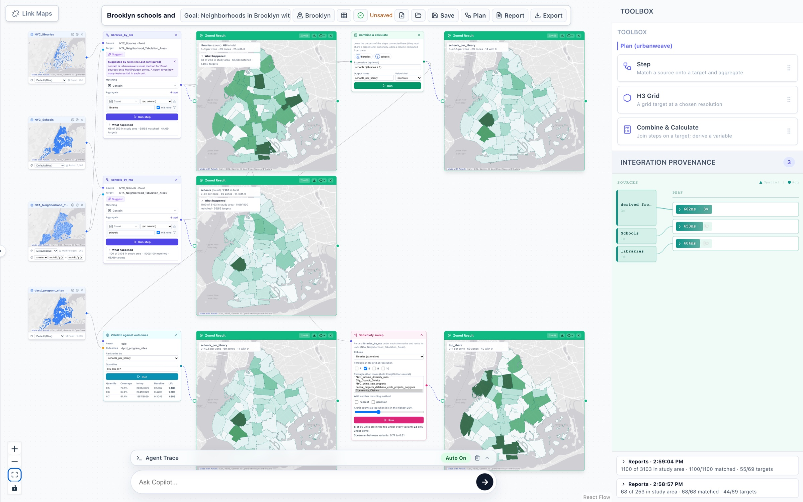

**New to UrbanTrace?** [docs/WALKTHROUGH.md](docs/WALKTHROUGH.md) takes one question (which Brooklyn
neighborhoods have many schools but few libraries?) through every part of the tool, explaining the
concepts as it goes. [docs/CASE_STUDY_2.md](docs/CASE_STUDY_2.md) then does the paper's second case
study (opportunity bargains: how rent changes which neighborhoods rank highest) on the canvas, with
priority maps and the Spatial Delta Map.

---

## 📄 Paper

**UrbanTrace: LLM-Assisted Discovery and Semantics-Aware Integration of Spatial Data**
Sonia Castelo, Eden Wu, Joao Rulff, Harish Doraiswamy, Juliana Freire, Claudio Silva
*Accepted to IEEE VIS 2026 (Full Papers Track); to appear in IEEE Transactions on Visualization and Computer Graphics.*

[arXiv:2607.25124](https://arxiv.org/abs/2607.25124) · [PDF](https://arxiv.org/pdf/2607.25124) · [Supplementary material](paper/Supplementary_Material.pdf)

The paper presents UrbanTrace as a visual analytics system that turns manual spatial data wrangling
into a transparent, node-based workflow in which users collaborate with context-aware LLM agents. An
offline profiler extracts semantic and geometric metadata from each dataset, which grounds the agents
when they discover datasets and recommend integration operators. The evaluation covers 28 urban
scenarios; the dataset discovery and operator selection studies are in [`benchmark/`](benchmark/README.md).

The paper describes UrbanTrace 1.0, before it ran on urbanweave; see [`paper/`](paper/README.md).
To reproduce its results, check out the tag `vis2026-camera-ready`. What changed in 2.0 (now in
alpha) is in [CHANGELOG.md](CHANGELOG.md).

If you use UrbanTrace, please cite:

```bibtex
@misc{castelo2026urbantrace,
  title         = {UrbanTrace: LLM-Assisted Discovery and Semantics-Aware Integration of Spatial Data},
  author        = {Castelo, Sonia and Wu, Eden and Rulff, Joao and Doraiswamy, Harish and Freire, Juliana and Silva, Claudio},
  year          = {2026},
  eprint        = {2607.25124},
  archivePrefix = {arXiv},
  primaryClass  = {cs.HC},
  doi           = {10.48550/arXiv.2607.25124},
  note          = {Accepted to IEEE VIS 2026; to appear in IEEE Transactions on Visualization and Computer Graphics}
}
```

---

## ✨ What it does

### 🗂️ Find data: the catalog (left sidebar)

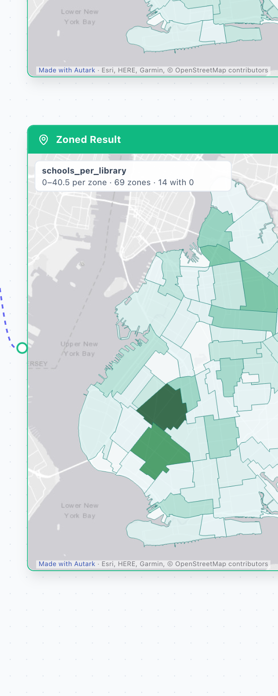

- 121 profiled NYC datasets, each with its geometry, row count, columns and a profile (**Info**): column
  types and statistics, where and when it has data, and where it came from (publisher, source URL,
  license when known). Rasters are listed alongside: tree canopy from NYC's 6-inch land cover and
  from NLCD.
- Search by name; filter to datasets with data **in the study area** (sorted by how much of it they
  reach) and to a range of **years**.
- Drag a dataset onto the canvas to use it; upload your own GeoJSON (with its source and license).
- The copilot suggests datasets for a goal; nothing is added until you accept it.

<br clear="right">

### 📦 Frame it: the collection (top bar)

A **collection** is what UrbanTrace produces: a goal, the datasets chosen and why, a study area, the
steps and analyses on the canvas, and where each dataset came from. It is saved on the server;
unsaved changes survive a reload.

- The **study area** (zones from a dataset, optionally filtered, or a box) narrows search, clips
  sources before they are combined, and bounds grids and exports.
- **Coverage** shows where each dataset has data in the study area; **checks** warn when periods do not
  overlap or a dataset has little or nothing there.

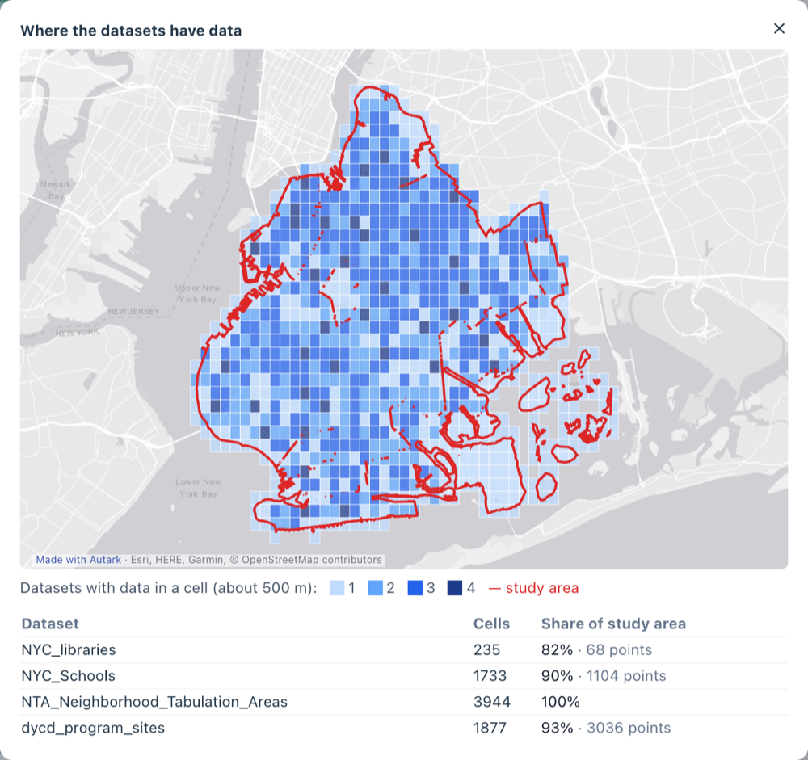

### 🔗 Prepare it: steps on urbanweave (canvas)

A **Step** turns a dataset into numbers per unit: a *source* (libraries) matched onto a *target*
(neighborhoods or an H3 grid) by a **matching method** (`contain`, `area_overlap`, `nearest`,
`gaussian`, ...) and summarised by **reductions** (count, sum, mean, majority, ...). Each column has
a **value kind** (extensive, intensive, categorical), which decides how it may be carried between units.

- The method picker comes from urbanweave's registry: each method has a figure and an explanation, and
  methods that do not fit the geometries are greyed out with the reason.
- **Suggest** asks the copilot for a method and reductions for this step and the collection's goal; its
  answer is checked against urbanweave's registry, and anything that does not fit is replaced, with the
  reason shown.
- After a run, the step reports what matched and what was left out and why, and the result map shows
  totals, ranges and units with nothing.
- **Join on a key**, the Step's second mode, adds rows to the zone whose code matches (ZIP, BBL,
  district) instead of matching by location, with sums and ratios of sums; keys that match no zone are
  reported.
- **Combine & Calculate** derives a variable from steps that share a target (`schools / (libraries + 1)`).
- The steps form an **urbanweave plan**; a run can be recorded and replayed.

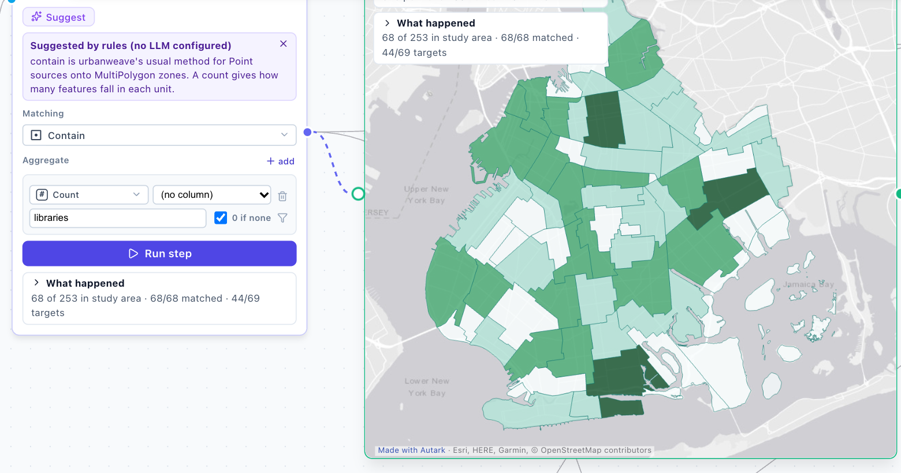

### 🛣️ Streets, rasters and more kinds of data

- **Streets (OSM)**: a node that makes the study area's street segments, or its intersections, a
  Step's target: trees per block, the nearest street of each school, crashes per km of street
  (`density`). The network is downloaded from OpenStreetMap (OSMnx) for the study area, once, and
  kept, so runs are fast and replayable; results are drawn as lines or points.
- **Rasters**: a Step with a raster source does **zonal statistics**, each cell weighted by the share
  of it inside each neighborhood or H3 cell (exactextract). The catalog has tree canopy from NYC's
  2021 6-inch land cover (`tools/fetch_tnc_canopy.py`, percent canopy per 30 ft cell) and from NLCD
  (30 m, any year 2011–2021; it misses most street trees in dense neighborhoods).
- **Whole datasets**: `tools/fetch_open_data.py <dataset>` fetches every row of an NYC Open Data
  dataset as GeoParquet and profiles it again (the catalog's copies were capped at 500,000 rows; the
  street-tree inventory now has all 1,125,266 trees).

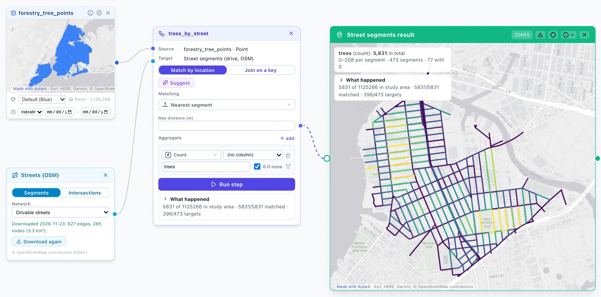

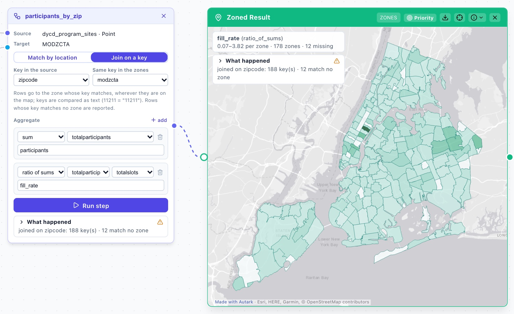 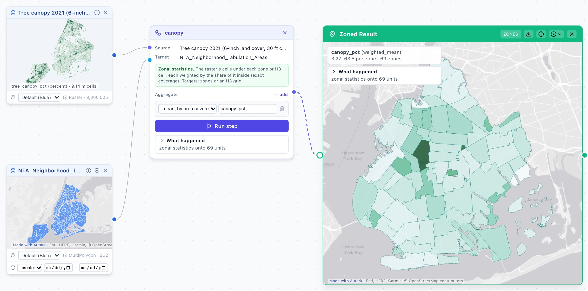

### 🔍 Check it: data quality with atlas-clean

**Check data** on a dataset node runs [atlas-clean](https://github.com/VIDA-NYU/atlas-clean)'s spatial
checks (swapped latitude and longitude, a wrong coordinate system, invalid or empty geometry,
duplicates, ...) and proposes fixes. Accepted fixes are saved as a recipe and replayed whenever the
dataset is used; steps, reports and exports say what was corrected.

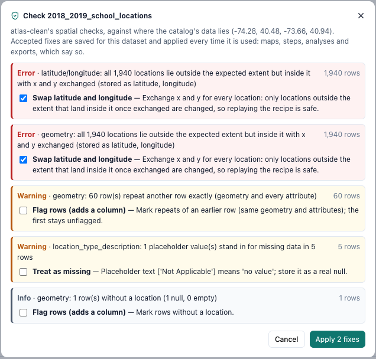

The same dialog **locates rows from their addresses** when they have none: the addresses go to
[NYC GeoSearch](https://geosearch.planninglabs.nyc/) only when you ask, each answer is checked against
the address sent (house number, street, borough), and the locations that check out are used whenever
the dataset loads.

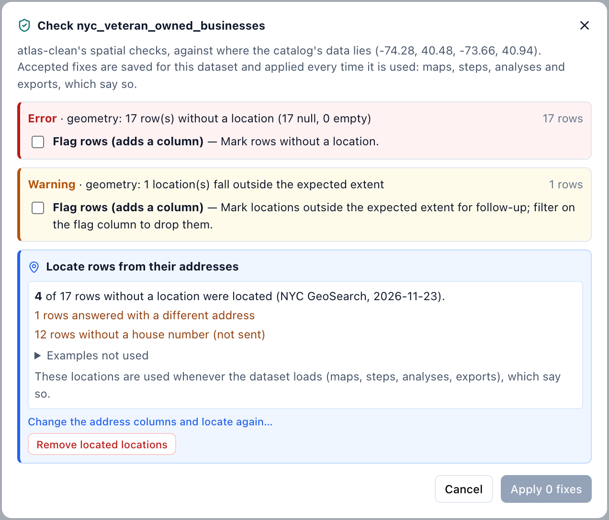

### 📊 Question it: analyses

| Node | What it answers |
|---|---|
| **Sensitivity Sweep** | Would the ranking change with other reasonable choices? Reruns a step through other H3 resolutions, zone systems or methods, brings each variant back to the step's units, and maps how often each unit is in the top. |
| **Validate** | Does the ranking line up with something observed? Coverage, baseline and lift of outcome points in the top units, per quantile. |
| **Dasymetric** | Spreads zone totals over finer units in proportion to point priors, keeping each zone's total. |
| **Compare Maps** | The **Spatial Delta Map**: where the priority score went up or down between two result maps, per unit. |

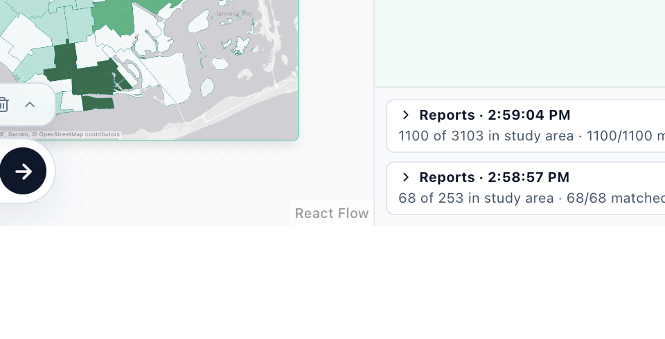 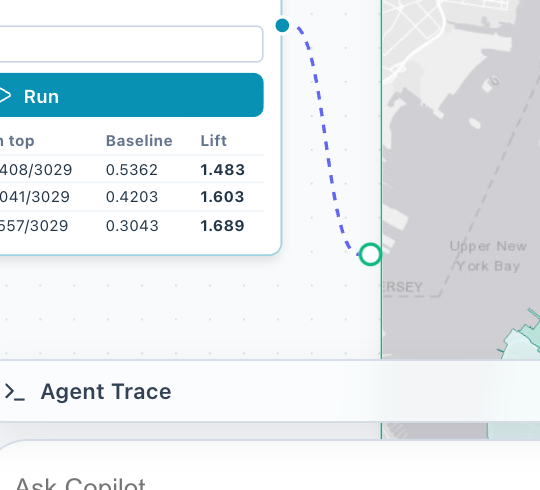

A result with several columns can be a **priority map**: one 0–1 score from its normalized columns,
each with a direction and a weight (the paper's Multivariate Priority Map). A Combine & Calculate
result opens as one; any other has a **Priority** button. The copilot proposes directions and weights
from the collection's goal, so a high score means what the goal looks for (need, risk, or
opportunity), and it does not count a total and its parts twice; without an LLM, keyword rules do,
and ask about the variables they cannot judge. **Tweak Weights** changes them; the index is recorded
with the collection. [docs/CASE_STUDY_2.md](docs/CASE_STUDY_2.md) uses both.

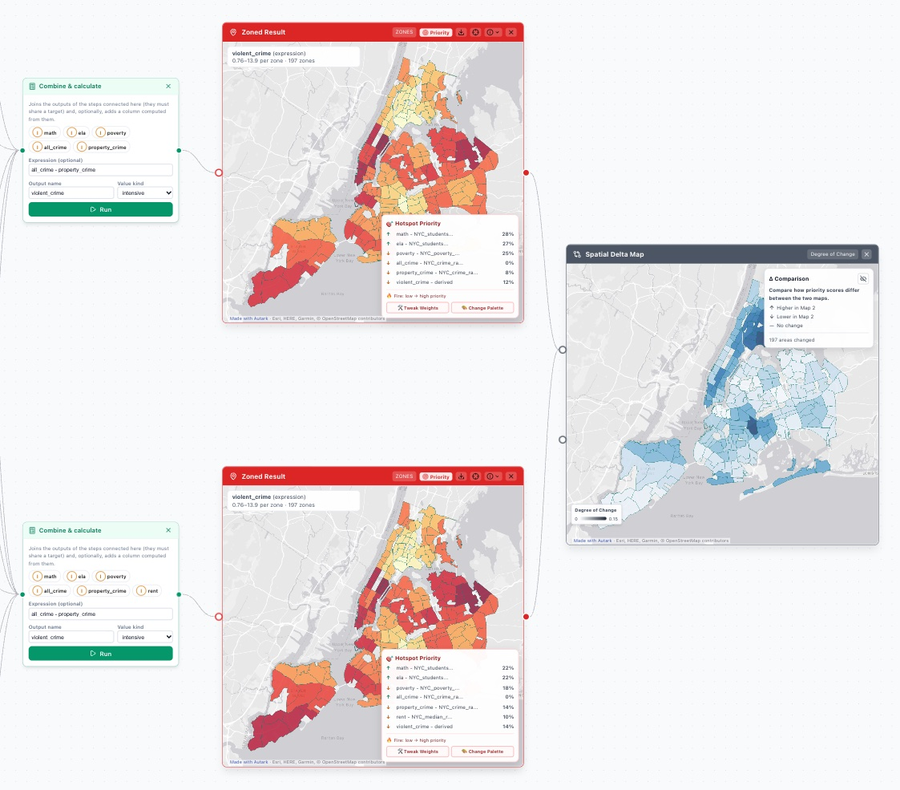

### 📤 Share it: report and export

- **Report** opens a printable page: goal, study area, datasets with their sources, a map and summary
  of each step, the analyses, and caveats.
- **Export** writes a zip that QGIS, GeoPandas, R or a notebook can open: a
  [Frictionless](https://datapackage.org/) `datapackage.json` describing every file, the sources
  (embedded when their license is recorded, otherwise referenced), the results, `plan.json` and
  `manifest.json` to rerun the steps with urbanweave, any atlas-clean recipes, and a README with the
  rationale and caveats. An exported zip can be opened back into UrbanTrace.

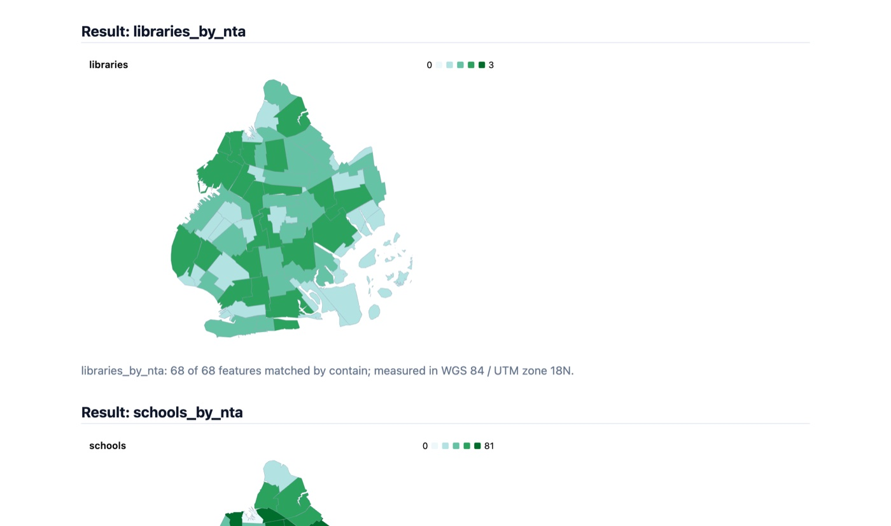

### 🧭 Provenance (right sidebar)

The **Integration Provenance Graph** logs each run: datasets as cards, matching methods as triangles
and aggregations as circles, and, on hover, why each was chosen (the copilot's reasoning, or what the
step's report says it did). Every number on a map can be traced back to its inputs and choices.

### 🤖 The copilot

The copilot suggests datasets for a goal, methods for a step, and the priority map's directions and
weights; every suggestion is checked (methods against urbanweave's registry) and nothing changes
until you accept it. It works without an LLM, by rules. The **LLM** chip in the copilot bar says what
it runs on and turns an LLM on or off: at startup the backend checks which providers work (keys
already in its environment or `backend/.env`, verified with a free request; nothing is entered in the
interface), and the chip offers to turn one on. A **local model** (Ollama, LM Studio, llama.cpp,
vLLM) keeps everything on the machine.

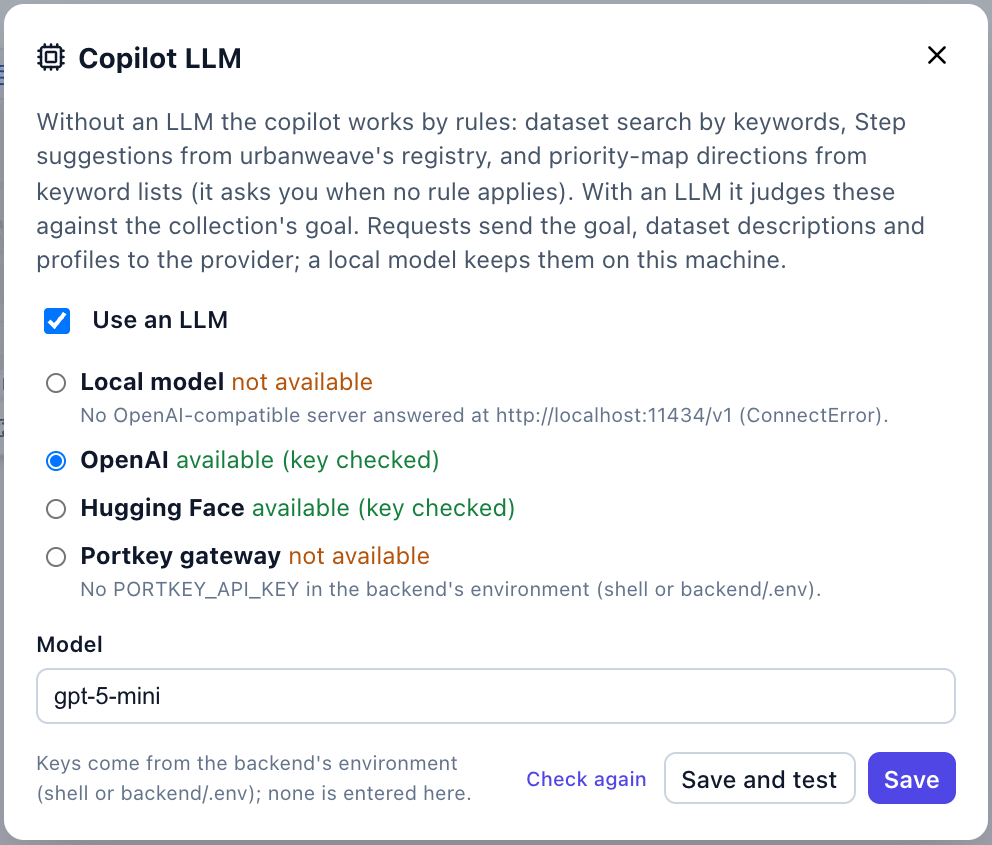

---

## 🧮 How integration works

Integration runs on [urbanweave](https://github.com/VIDA-NYU/urbanweave). A step is one
`match` (which target each source feature belongs to, and with what weight) followed by `aggregate`
(what to compute per target), measured in the local UTM zone. Missing values stay missing, value
kinds decide how a column may be summarised, and every step reports what it matched, what it left out
and why. The steps of a collection form an urbanweave plan (`plan.json`), so the same integration
runs unchanged in a notebook:

```python
import geopandas as gpd
import urbanweave as uw
plan = uw.Plan.from_json("plan.json")
run = plan.run({"NYC_libraries": gpd.read_parquet("data/sources/NYC_libraries.parquet")})
```

The redesign that moved UrbanTrace onto urbanweave, and what changed from the paper's version, is in
[docs/REDESIGN.md](docs/REDESIGN.md); progress and what is left are in [PLAN.md](PLAN.md).

---

## 🏗️ Tech stack

| Layer | Technology |
|---|---|
| Frontend | React 19, Vite, React Flow (`@xyflow/react`), Lucide icons |
| Maps | [Autark](https://autarkjs.org/) `autk-map` (WebGPU): projection, picking and tooltips, over an Esri light-gray basemap; `h3-js` |
| Backend | Python, FastAPI, GeoPandas, Shapely, H3 |
| Integration | [urbanweave](https://github.com/VIDA-NYU/urbanweave) (`0.1.0a2`) |
| Data quality | [atlas-clean](https://github.com/VIDA-NYU/atlas-clean) (optional); geocoding with [NYC GeoSearch](https://geosearch.planninglabs.nyc/) |
| Streets and rasters | OSMnx (OpenStreetMap networks), rasterio and exactextract (zonal statistics), through urbanweave's `osm` and `raster` extras |
| Profiling | [atlas-profiler](https://github.com/VIDA-NYU/atlas-profiler) profiles; AutoDDG dataset descriptions |
| Export | Frictionless Data Package; GeoParquet, GeoPackage, GeoJSON |
| LLM | OpenAI, Hugging Face Inference Providers, a Portkey gateway, or a local OpenAI-compatible server; optional |
| Data | GeoJSON and GeoParquet, GeoTIFF rasters, stored with Git LFS |

---

## 📁 Project structure

```text
urbantrace/
├── backend/
│   ├── main.py                  # FastAPI app and endpoints
│   ├── plans.py                 # Running the canvas as an urbanweave plan
│   ├── analysis.py              # Sweeps, validation, dasymetric, priority, the report
│   ├── scope.py                 # Study area, coverage, time, checks
│   ├── catalog.py               # Datasets, profiles, origins, hashes
│   ├── cleaning.py              # Data checks and corrections with atlas-clean
│   ├── geocode.py               # Locating rows from their addresses (NYC GeoSearch)
│   ├── osm.py                   # OpenStreetMap street networks for the study area
│   ├── rasters.py               # Raster datasets, previews, zonal statistics sources
│   ├── suggest.py               # The copilot's step suggestions, checked against the registry
│   ├── copilot_settings.py      # The copilot's LLM: providers found, on/off, model
│   ├── collections_store.py     # Saved collections
│   ├── export.py                # Data packages
│   ├── geometry.py              # Geometry repair
│   ├── llm_agent.py, tool.py    # Copilot (LLM agent, prompts and tools)
│   ├── upload_new_data.py       # Upload and profiling
│   └── tests/                   # On small synthetic data; no LFS needed
├── frontend/src/
│   ├── components/
│   │   ├── canvas/              # The canvas and its nodes (dataset, step, grid, calculate, analyses, results)
│   │   ├── collection/          # Collection bar, study area, coverage
│   │   ├── methods/             # Method picker, icons, report cards
│   │   ├── catalog/             # Dataset cards, details, Check data
│   │   ├── visualization/       # Autark maps
│   │   ├── layout/              # Sidebars and provenance panel
│   │   └── copilot/, toolbox/
│   └── lib/                     # Plans, collections, scope, analyses, cleaning, registry
├── data/                        # Dataset lake (Git LFS), profiles, origins, recipes
├── docs/                        # WALKTHROUGH.md, CASE_STUDY_2.md, REDESIGN.md, screenshots
├── paper/                       # The VIS 2026 paper's supplementary material
├── benchmark/                   # Discovery and operator-selection studies (paper)
├── notebook/                    # Case study notebooks (after-school and opportunity bargains)
└── tools/                       # Whole-catalog run, fetching datasets and rasters, GeoParquet, origins
```

---

## 🛠️ Setup

### Prerequisites
- **Node.js** 20.19+ (required by Vite 7)
- **Python** 3.10+
- **Git LFS**, to get the datasets
- A browser with **WebGPU** for the maps: a recent Chrome or Edge

### Data
The datasets are stored with Git LFS, about 18 GB in total. After cloning:

```bash
git lfs install
git lfs pull                                   # or only what the app uses (about 9 GB):
git lfs pull --include="data/geojson/*,data/geoparquet/*,data/raster/*,data/metadata_v2/*"
```

### Backend
```bash
cd backend
python3 -m venv venv
source venv/bin/activate
pip install -r requirements.txt
pip install -e "../../atlas-clean[geo]"   # optional: data checks (a checkout of atlas-clean next to this repository)
python ../tools/fetch_tnc_canopy.py    # optional: tree canopy from NYC's 6-inch 2021 land cover (1.74 GB download, ~5 min) into data/raster/
python ../tools/fetch_nlcd_canopy.py   # optional: NLCD tree canopy (30 m, any year 2011-2021; misses street trees in dense areas)
pip install openai                         # optional: the OpenAI or Hugging Face copilot (portkey-ai for Portkey)
uvicorn main:app --reload --port 8000
```

The backend loads `backend/.env`. The copilot's LLM is optional and chosen in the interface (see
[The copilot](#-the-copilot)); the variables below set the defaults and the providers' keys.

| Variable | Purpose |
|---|---|
| `LLM_PROVIDER` | `openai`, `huggingface`, `portkey` or `local` (default `portkey`); the interface's choice overrides it |
| `LOCAL_LLM_BASE_URL`, `LOCAL_LLM_MODEL` | A local OpenAI-compatible server (default `http://localhost:11434/v1`, Ollama) and its model; `LOCAL_LLM_TIMEOUT` in seconds (default 300) |
| `OPENAI_API_KEY`, `OPENAI_MODEL` | OpenAI credentials and model (default `gpt-5-mini`) |
| `HF_TOKEN`, `HF_MODEL` | Hugging Face token and model, served through [Inference Providers](https://huggingface.co/docs/inference-providers) (default `openai/gpt-oss-120b`; append `:<provider>` to pin a provider) |
| `PORTKEY_API_KEY`, `PORTKEY_MODEL` | Portkey gateway credentials and model |
| `COPILOT_DISABLED` | Set to `1` to start with the LLM off (rules only) until it is turned on in the interface |
| `URBANTRACE_OSM_MAX_KM2` | Largest study area whose street network is downloaded from OpenStreetMap (default 1000 km²) |
| `URBANTRACE_GEOCODER` | `off` turns off locating rows from their addresses (NYC GeoSearch, only on an analyst's request) |
| `URBANTRACE_LLM_CHECK` | `off` skips the providers check at startup (no requests to providers) |
| `COPILOT_CATALOG` | How the catalog is sent to the model: `index` (default), `compact` or `full` |
| `URBANTRACE_COLLECTIONS_DIR` | Where collections are saved (default `data/collections`) |
| `URBANTRACE_PLAN_CACHE` | Where plan runs and manifests are kept (default `data/plan_cache`) |

The copilot needs a model that supports tool calling. With the default `index` catalog, each request
carries one line per dataset (about 5.5k tokens for 121 datasets) and the model reads a dataset's full
description through a `get_dataset_details` tool. A polygon dataset's line ends with its number of
polygons and the columns that identify one (`[262 polygons, keys nta2020/ntaname/ntaabbrev]`), so the
model can tell neighborhoods from sub-borough areas or ZIP codes without asking; `compact` (about 42k tokens) and `full` (about 86k)
send more up front (`backend/catalog_format.py`).

### Frontend
```bash
cd frontend
npm install
npm run dev
```

The app runs at **http://localhost:5173** and expects the backend at `http://localhost:8000`; set
`VITE_API_BASE_URL` (for example in `frontend/.env.local`) to use another address.

The maps use Autark's `autk-map` and `autk-core`, bundled in [`frontend/vendor/`](frontend/vendor/README.md)
until a release of Autark includes what UrbanTrace uses (hover and tooltips, pointer positions under
CSS transforms; both are open pull requests upstream). No Autark checkout is needed.

### Tests
```bash
cd backend
pip install -r requirements-dev.txt
python -m pytest -q
```

The tests use small synthetic datasets, so they need no LFS data; the data-check tests run when
atlas-clean is installed.

---

## 🌐 API

| Method | Endpoint | Purpose |
|---|---|---|
| GET | `/datasets`, `/datasets/{id}/details`, `/dataset/{name}?simplify=` | The catalog; a dataset's metadata; a dataset as GeoJSON (with its saved corrections) |
| POST | `/datasets/upload` | Upload and profile a GeoJSON file |
| GET | `/datasets/{id}/origin`, `/api/datasets/{id}/value-kinds` | Where a dataset came from; suggested value kinds |
| GET/POST | `/api/catalog/index`, `/api/catalog/in-area` | Search filters; each dataset's share of a study area |
| GET/POST | `/api/study-area/options/{id}`, `/api/study-area/resolve`, `/api/coverage`, `/api/collections/check` | Study area, coverage, checks |
| GET | `/api/operators` | Methods and reductions from urbanweave's registry |
| POST | `/api/plan/validate`, `/api/plan/run`, `/api/plan/replay` | Check, run (results in columns) and replay an urbanweave plan |
| POST | `/api/analysis/sweep`, `/api/analysis/validate`, `/api/analysis/dasymetric` | Sensitivity sweeps, validation against outcomes, dasymetric disaggregation |
| POST/GET/DELETE | `/api/datasets/{id}/check`, `/api/datasets/{id}/recipe` | Data checks with atlas-clean; saved corrections |
| GET/POST/PUT/DELETE | `/api/collections[/{id}]` | Collections |
| POST | `/api/collections/{id}/export`, `/api/collections/import`, `/api/results/export` | Export a collection or one result as a zip; import a package |
| GET | `/api/collections/{id}/report` | The collection as a printable HTML report |
| POST/GET/DELETE | `/api/datasets/{id}/geocode`, `/api/datasets/{id}/geocode/preview` | Locate rows from their addresses (preview sends nothing); saved locations |
| POST | `/api/osm/network`, `/api/osm/network/download` | Whether the study area's street network is downloaded; download it |
| GET | `/api/rasters/{id}`, `/api/rasters/{id}/preview.png` | A raster dataset's description and preview |
| POST | `/api/copilot/chat`, `/api/copilot/suggest-step`, `/api/v1/copilot/synthesize-hotspot` | Copilot chat with the canvas as context; a step's method and reductions; the priority map's directions and weights |
| GET/POST/DELETE | `/api/copilot/settings`, `/api/copilot/check`, `/api/copilot/test` | The copilot's LLM: providers found, on/off and model, a test request |

---

## 📦 Data

The data lake covers 121 profiled NYC datasets, including demographics, income and poverty, housing,
air quality and heat vulnerability, crime and collisions, pedestrian and bicycle counts, schools,
libraries, street trees and taxi trips, plus reporting zones (NTAs, MODZCTA ZIP areas, community
districts and council districts).

| Path | Contents |
|---|---|
| `data/geojson/` | Datasets used by the app, by name |
| `data/geoparquet/` | Whole datasets fetched again (`tools/fetch_open_data.py`); preferred to the GeoJSON |
| `data/raster/` | Raster datasets (GeoTIFF) with a sidecar JSON: band, units, value kind, source, license |
| `data/metadata_v2/` | atlas-profiler profiles: columns, value statistics, where and when each dataset has data |
| `data/metadata/` | The original profiles (read by the copilot and the benchmark) |
| `data/origins.json` | Where each dataset came from: publisher, source URL, license when recorded |
| `data/recipes/` | atlas-clean corrections accepted for a dataset, replayed when it loads |
| `data/geocoded/`, `data/osm/` | Rows located from addresses; downloaded street networks (local, not committed) |
| `data/geojson_raw/`, `data/metadata_raw/` | The datasets by their NYC Open Data IDs, for the discovery benchmark |
| `data/descriptions_ddg.csv`, `data/descriptions_origin.csv` | AutoDDG and source-catalog descriptions |

Some source datasets contain bad coordinates (swapped latitude and longitude, a mislabelled
coordinate system, stray points far from NYC); **Check data** finds them, and map previews frame the
area where most features are. Three are corrected in the repository (`data/recipes/`):
`2018_2019_school_locations` (latitude and longitude swapped), `raised_crosswalk_locations` and
`street_closures_due_to_construction_activities_by_intersection` (NY State Plane feet labelled as
degrees).

---

## 🔬 Benchmark and case studies (paper)

- [`benchmark/`](benchmark/README.md): the dataset discovery ablation (28 scenarios, five metadata
  conditions, two LLM backbones) and the operator selection study, with scripts and results. The
  operator selection study scores answers in the paper's operator vocabulary; run it against
  `vis2026-camera-ready`.
- [`notebook/case_study_1/`](notebook/case_study_1/): validation notebook for the NYC after-school case study.
- Case study 2, opportunity bargains: [the notebook](notebook/case_study_2/Case_Study_2-NYC_Opportunity_Bargains.ipynb)
  recreates the 2017 opportunity and rent comparison with UrbanTrace's plan runner, and
  [docs/CASE_STUDY_2.md](docs/CASE_STUDY_2.md) does it on the canvas.

---

## License

UrbanTrace's code is released under the [MIT License](LICENSE). The datasets in `data/` keep their own terms, recorded in `data/origins.json` and in each raster's sidecar (for example, the 6-inch tree canopy is CC BY-NC-SA 4.0); exports carry them.

---

## 🙏 Acknowledgements

Developed by the OSCUR team at [VIDA-NYU](https://github.com/VIDA-NYU).

UrbanTrace is part of [OSCUR](https://oscur.org/), the Open-Source Cyberinfrastructure for Urban
Computing project, supported by the National Science Foundation under Awards
[#2411221](https://www.nsf.gov/awardsearch/show-award/?AWD_ID=2411221),
[#2411222](https://www.nsf.gov/awardsearch/show-award/?AWD_ID=2411222) and
[#2411223](https://www.nsf.gov/awardsearch/show-award/?AWD_ID=2411223). Any opinions, findings, and
conclusions or recommendations expressed in this material are those of the authors and do not
necessarily reflect the views of the National Science Foundation.

<a href="https://oscur.org/"></a>
