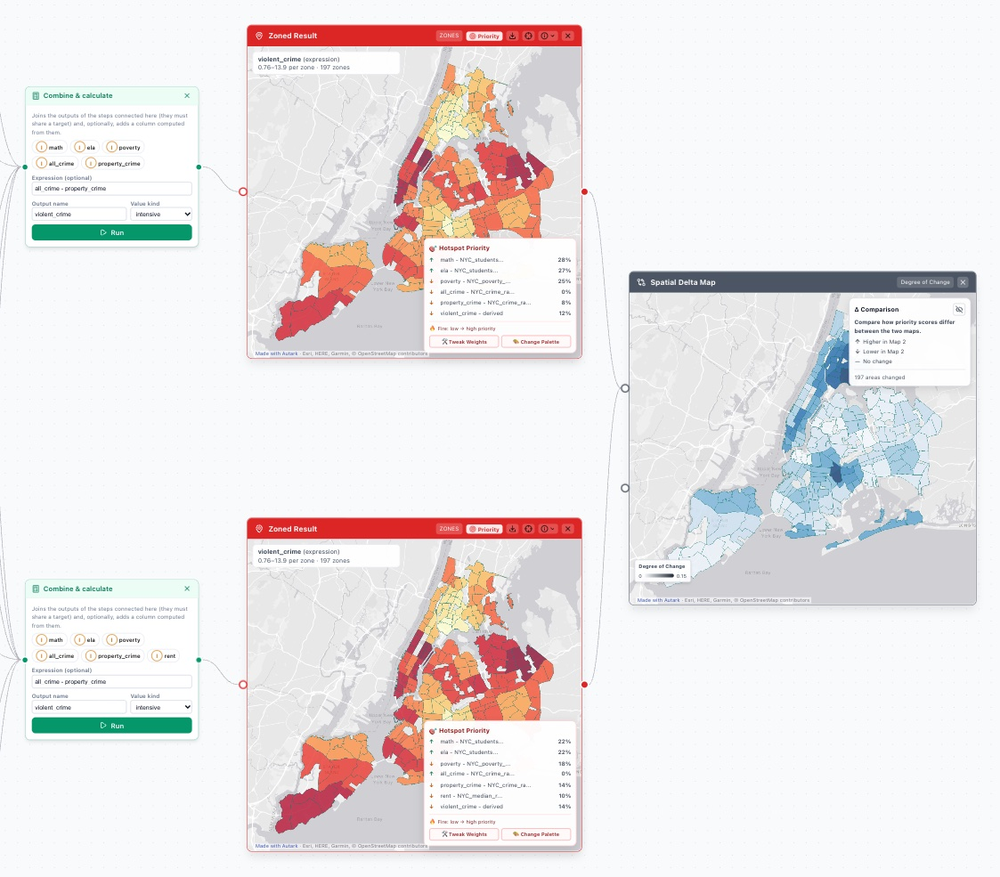

# Case study: opportunity bargains in New York City

The second case study in the [UrbanTrace paper](https://arxiv.org/html/2607.25124v1#S3.SS4), done on
the canvas:

> **How does accounting for rent change which neighborhoods rank highest for opportunity?**

It combines school performance, crime and poverty into an opportunity score per neighborhood, adds
median rent, and maps where the score goes up or down. Where [WALKTHROUGH.md](WALKTHROUGH.md)
counts features, this one uses what the walkthrough does not: indicators on two different
geographies brought onto one, a derived variable, the **priority map** with the copilot's weights,
and the **Spatial Delta Map**.

The same analysis in code, with the numbers to check against, is the notebook
[`notebook/case_study_2/`](../notebook/case_study_2/Case_Study_2-NYC_Opportunity_Bargains.ipynb).
It calls the same plan runner, so the steps below should give its values.

## The data

Six indicators for **2017** (the `2017` column of each layer), on two geographies:

| Indicator | Catalog dataset | Source units | More of it means |
|---|---|---|---|
| Fourth-grade math proficiency | `NYC_students_performing_math` | 59 community districts | more opportunity |
| Fourth-grade English proficiency | `NYC_students_performing_english_language_arts` | 59 community districts | more opportunity |
| Serious crime per 1,000 residents | `NYC_crime_rate_per_1000_residents` | 59 community districts | less |
| Serious property crime per 1,000 | `NYC_crime_rate_property` | 59 community districts | less |
| Poverty rate | `NYC_poverty_rate` | 55 sub-borough areas | less |
| Median gross rent (2024 dollars) | `NYC_median_rent` | 55 sub-borough areas | less (more affordable) |

Violent crime is not a layer of its own: it is all serious crime minus property crime, derived on
the canvas. The units the analysis reports in are the **197 residential 2020 Neighborhood
Tabulation Areas** (NTAs with `ntatype` 0).

## 1. Set up the collection

1. Name it *Opportunity bargains* and give it the goal: *Find neighborhoods with good opportunity
   (schools, low crime, low poverty) that are affordable (low rent)*. The goal matters here: the
   copilot reads it to decide what a high score means (see step 4).
2. **Study area**: the zones dataset `NTA_Neighborhood_Tabulation_Areas`, keeping zones where
   `ntatype` is `0`. The bar shows the 197 residential NTAs; both scenarios use exactly these, so
   their scores are comparable.

## 2. Bring every indicator onto the neighborhoods

Drag the six datasets and `NTA_Neighborhood_Tabulation_Areas` onto the canvas. For each dataset,
add a **Step**:

- **Source**: the dataset; **Target**: the NTA node.
- **Matching**: **Area overlap**. Each NTA takes a share of every source area it overlaps, weighted
  by the shared area.
- **Aggregate**: **Weighted mean** of the `2017` column, value kind *intensive* (a rate or a median
  does not add up when areas are merged). Name the outputs `math`, `ela`, `all_crime`,
  `property_crime`, `poverty` and `rent`.
- **Run step**.

**What you should see.** Every step reports *59 of 59 in study area · 59/59 matched · 197/197
targets* (55 for poverty and rent): every source area reached the study area, and every NTA got a
value. The poverty and rent steps also report two repaired geometries (a ⚠ on the card): two
sub-borough polygons are invalid in the source and are repaired before matching.

**What the numbers are.** Area-weighted averages: an NTA's rent is the average of the sub-borough
medians it overlaps, weighted by overlap. They assume each source value holds throughout its area,
which is the usual caveat of moving data between geographies.

## 3. Derive violent crime and combine

Add two **Combine & Calculate** nodes, one per scenario:

| Node | Steps connected | Expression | Output |
|---|---|---|---|
| Baseline | math, ela, poverty, all_crime, property_crime | `all_crime - property_crime` | `violent_crime` |
| With rent | the same and rent | `all_crime - property_crime` | `violent_crime` |

Run both. Each opens a result map with a red header: a Combine & Calculate result opens as a
**priority map**, which combines its columns into one 0–1 score. (Any other result with several
columns has a **Priority** button in its header to do the same.)

## 4. Read the weights

The **Hotspot Priority** card on each map lists every variable with a direction (↑: more of it
raises the score; ↓: lowers it) and a weight. With the copilot's LLM on (the **LLM** chip in the
copilot bar), the copilot proposes them from the collection's goal. For this goal it sets:

| Variable | Baseline | With rent | Paper's figure (baseline) |
|---|---|---|---|
| math ↑ | 28% | 18–22% | 28% |
| ela ↑ | 27–28% | 18–22% | 26% |
| poverty ↓ | 19–25% | 18% | 25% |
| violent_crime ↓ | 12–15% | 14–16% | 12% |
| property_crime ↓ | 8–10% | 12–14% | 10% |
| all_crime | 0% | 0% | (not used) |
| rent ↓ | | 10–18% | |

The ranges are from several runs: an LLM does not give exactly the same weights every time. Two
things to check on the card:

- **Directions.** For an opportunity goal, a high score means more opportunity: schools ↑, crime,
  poverty and rent ↓. (For a goal about need or risk, the copilot sets them the other way.)
- **No double counting.** `all_crime` is the total that violent and property crime split, so it gets
  0%; counting it as well would count crime twice.

Without an LLM, keyword rules set the directions and mark the ones they cannot judge with **?**
(those stay out of the score until you choose ↑ or ↓). Either way, **Tweak Weights** lets you set
weights and directions yourself, for instance the paper's published ones. The weights are kept with
the collection and recomputed in the report and the export.

## 5. Map the change

Drag **Compare Maps** (toolbox → *Analysis*) and connect the **baseline** result map first and the
**with rent** map second, so the change reads as *with rent − baseline*.

**What you should see.** The **Spatial Delta Map** shades each NTA by how much its score moved (the
**Degree of Change** button adds arrows for up and down); its card says how many areas changed (all 197 in the run above, by up to
about 0.15). Hover an NTA for both scores and the difference.

The notebook does the same with the paper's rounded weights, and with a third scenario that keeps the
baseline's proportions and only adds rent (27%), so the change isolates rent:

| | Published weights + rent | Rent only |
|---|---|---|
| NTAs whose score rose | 107 | 116 |
| NTAs whose score fell | 90 | 81 |
| Largest rise | Brownsville, 0.149 → 0.400 | +0.230 |
| Largest fall | West Village, 0.904 → 0.654 | −0.244 |

## How to read it

Adding rent rewards neighborhoods where opportunity is moderate and rent is low (Brownsville, Mott
Haven, Melrose) and penalizes expensive ones whose opportunity was already high (West Village,
Greenwich Village, the Financial District). A rise is a gain *relative to the baseline*; read it
together with the final score, which says where affordability and opportunity coincide.

The scores describe the indicators and weights you chose. The original SVP research behind this case
study finds bargains differently, as rents below what a model predicts from opportunity and housing
characteristics, not as an affordability indicator in a weighted score
([Furman Center](https://www.furmancenter.org/publication/planning-for-opportunity-how-planners-can-expand-access-to-affordable-opportunity-bargain-areas/)).

## Keep and share

**Save**, then **Report** and **Export** as in [WALKTHROUGH.md](WALKTHROUGH.md#part-5-keep-and-share):
the export holds the six sources, the NTA targets, both scenarios' results with their priority
scores and weights, the plan, and the manifest to rerun it.
