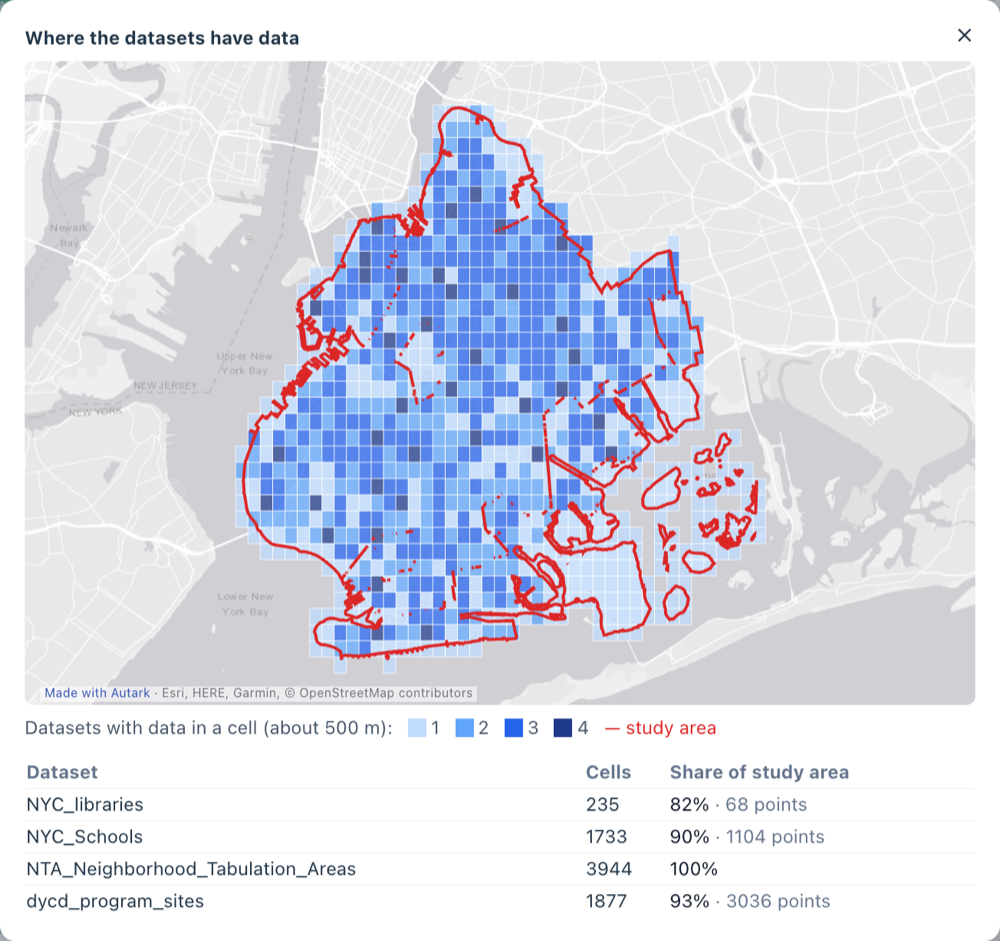
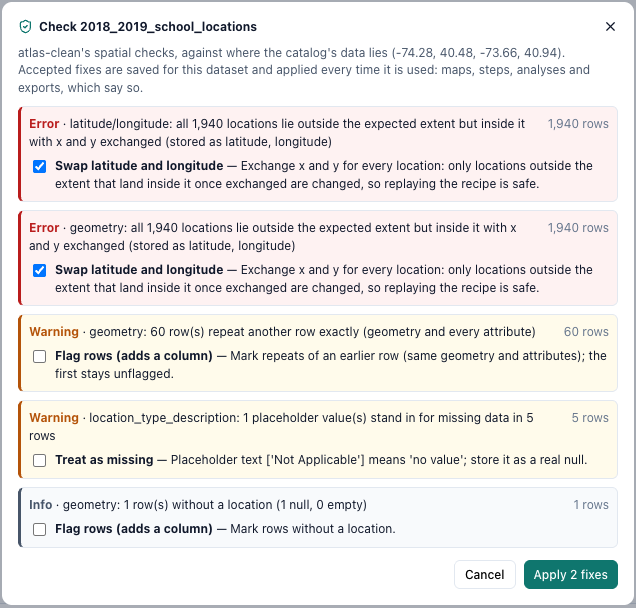
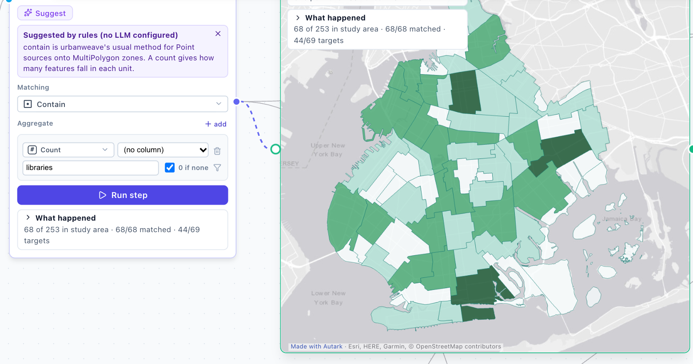
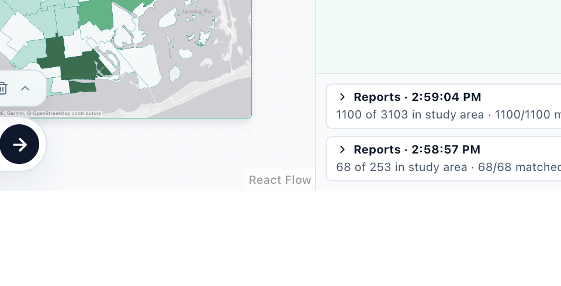
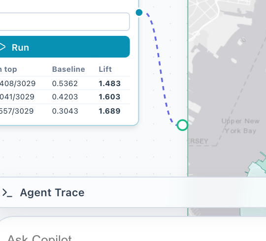
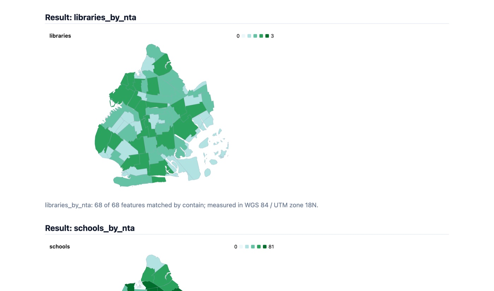

# UrbanTrace walkthrough: schools and libraries in Brooklyn

This walkthrough takes one question from start to finish through every part of UrbanTrace:

> **Which Brooklyn neighborhoods have many schools but few libraries?**

Along the way it explains what each part is for and the ideas behind it. It takes about an hour.
The numbers quoted are what the current version produces on the catalog in this repository, so you
can check your screen against them.

**Contents**

- [What UrbanTrace is for](#what-urbantrace-is-for)
- [Concepts](#concepts)
- [Setup](#setup)
- [A tour of the screen](#a-tour-of-the-screen)
- [Part 1: Set up the collection](#part-1-set-up-the-collection)
- [Part 2: Bring in data and check coverage](#part-2-bring-in-data-and-check-coverage)
- [Part 3: Turn datasets into numbers per neighborhood](#part-3-turn-datasets-into-numbers-per-neighborhood)
- [Part 4: How far to trust the numbers](#part-4-how-far-to-trust-the-numbers)
- [Part 5: Keep and share](#part-5-keep-and-share)
- [Where to go next](#where-to-go-next)
- [Troubleshooting](#troubleshooting)

## What UrbanTrace is for

Answering an urban question usually means finding a handful of datasets that were never meant to be
used together, getting them onto common units, and keeping track of what was done so someone else
can trust and reuse the result. UrbanTrace helps with each part:

1. **Find data**: search a catalog of profiled datasets, filtered by place and period.
2. **Prepare it**: bring datasets onto shared units (neighborhoods, an H3 grid) with explicit,
   documented methods.
3. **Analyse it**: combine variables, test how sensitive the result is to your choices, and check
   it against observed outcomes.
4. **Record and export it**: a collection with its goal, sources, methods and caveats, exported as a
   package that QGIS, GeoPandas, R or a notebook can open, and that can be rerun.

The integration itself runs on [urbanweave](https://github.com/VIDA-NYU/urbanweave), a Python
package; UrbanTrace is the interface around it.

## Concepts

| Concept | What it means here |
|---|---|
| **Catalog** | The datasets UrbanTrace knows about: NYC Open Data and similar, each with a **profile** (columns, types, where and when it has data) made by atlas-profiler, and an **origin** record (publisher, source URL, license when known). |
| **Collection** | What you are building: a goal, the datasets you chose, a study area, and the steps and analyses on the canvas. It is saved on the server and is the thing that gets exported. |
| **Study area** | Where the analysis applies. It narrows search to datasets with data there, clips sources before they are combined, and bounds grids and exports. |
| **Coverage** | How much of the study area a dataset reaches. For polygons and lines, the share of the area's ~500 m cells with data; for points, how far the points spread across the area, and how many fall inside it. |
| **Source and target** | A **source** is the data being counted or summarised (libraries). A **target** is the set of units results are reported in (neighborhoods, or an H3 grid). |
| **Step** | One integration: a source onto a target. **Matching** decides which unit each source feature belongs to (`contain`: the point is inside the polygon); **aggregation** decides what to compute per unit (a count, a sum, a mean). |
| **Value kind** | How a column behaves when units are split or merged. **Extensive** values add up (counts, population); **intensive** values are averages or rates (density, schools per library); **categorical** values are labels. The kind decides how a value is carried from one set of units to another. |
| **H3 grid** | A grid of hexagons covering the earth at fixed resolutions (resolution 8 cells are about 0.7 km²). Useful when no administrative units fit, or to check that a result does not depend on the zones chosen. |
| **Plan** | The steps of a collection written as urbanweave's plan JSON, so they run unchanged in a notebook. A **run** of the plan is recorded in a **manifest**: inputs by fingerprint, versions, and what each step did. |
| **Derived variable** | A new number per unit computed from step outputs, e.g. `schools / (libraries + 1)`. |
| **Sensitivity sweep** | Reruns a step under alternative choices (other units, other methods) and shows which units rank highly under all of them and which only under some. |
| **Validation** | Ranks units by a result and checks whether observed outcome points concentrate in the top units more than chance would predict. |
| **Report and export** | The report is a printable page for people. The export is a zip for other tools: data, a `datapackage.json` (a [Frictionless Data Package](https://datapackage.org/)), a README, the plan and the manifest. |

## Setup

From the repository root, start the backend and the frontend in two terminals:

```sh
cd backend && ./venv/bin/uvicorn main:app --port 8000
cd frontend && npm run dev
```

Open `http://localhost:5173`. Maps need a browser with WebGPU (recent Chrome or Edge). After
pulling new backend code, restart the backend: it does not reload by itself.

The copilot works without an LLM, by rules. To let it use one, click the **LLM** chip in the copilot
bar at the bottom: at startup the backend checks which providers it can use (keys already in its
environment or `backend/.env`, or a model server running on this machine), and the chip reads
*LLM available · turn on* when one works. This walkthrough's numbers do not depend on it.

## A tour of the screen

- **Left sidebar: the catalog.** Search by name; filter to datasets with data in the study area and
  to a range of years. Each card shows the geometry, row count and columns; **Info** opens the
  profile. Drag a card onto the canvas to use it.
- **Centre: the canvas.** Nodes for datasets, steps, results and analyses, connected left to right.
  Scroll to zoom, drag the background to pan; the controls at the bottom left include *fit view*.
- **Top of the canvas: the collection bar.**

  | Item | What it does |
  |---|---|
  | **Name** | Titles the report and the export. |
  | **Goal** | One or two sentences on what the data is for; goes into the README and report. |
  | **Study area** | Opens the study area panel. |
  | **Grid icon** | Coverage: where the datasets on the canvas have data. |
  | **✓ / ⚠** | Checks: periods that don't overlap, datasets with little or no data in the study area. |
  | **Saved / Unsaved** | Whether the canvas has changes not yet saved. |
  | **New, Open, Save** | Collections live on the server. Open also imports an exported zip. |
  | **Plan** | Appears once there are steps: run all and record the run, replay it, download `plan.json`. |
  | **Report** | The printable page. |
  | **Export** | The zip. |

- **Right sidebar: the toolbox** (nodes to drag onto the canvas: *Plan (urbanweave)*, with Step,
  H3 Grid, Streets (OSM) and Combine & Calculate, and *Analysis*) and the **provenance panel**,
  which logs each run: the datasets as cards, the matching methods as triangles and the
  aggregations as circles; hover one for the reason it was chosen.
- **Bottom: the copilot bar.** Ask the copilot in words; the **LLM** chip says what it runs on.

Unsaved changes are kept in the browser and restored after a reload, and the browser asks before
leaving with unsaved changes. The last saved collection reopens on its own.

## Part 1: Set up the collection

**Goal:** say what the analysis is for and where it applies, before choosing data.

1. Give the collection a name, e.g. *Brooklyn schools and libraries*.
2. Click **Add a goal** and write: *Neighborhoods in Brooklyn with schools but few libraries*.
3. Click **No study area**. Choose the zones dataset `NTA_Neighborhood_Tabulation_Areas`, then under
   *Keep only zones where*, the column `boroname` and the value `Brooklyn`. The bar now shows
   *Brooklyn*.
4. In the sidebar, tick **In study area**.

**What you should see.** The catalog barely shrinks: almost every dataset covers the whole city, so
almost every dataset has data in Brooklyn. The filter matters for smaller areas, and for the
datasets that don't reach it at all (the Central Park squirrel census disappears).

**Why the study area matters.** Everything downstream uses it: sources are clipped to Brooklyn
before they are counted, results cover Brooklyn's 69 neighborhoods only, and exports are clipped.
Neighborhoods that merely share a border with Brooklyn are left out; a zone needs at least 1% of
its area inside.

## Part 2: Bring in data and check coverage

**Goal:** choose the datasets and check that they actually cover the study area.

1. Drag three datasets onto the canvas: `NYC_libraries`, `NYC_Schools` and
   `NTA_Neighborhood_Tabulation_Areas`. Each node shows a small map of the whole dataset (not yet
   clipped).
2. Click the **grid icon** in the collection bar.

**What you should see.** A map of Brooklyn over a gray basemap, outlined in red, with ~500 m squares
shaded by how many of the three datasets have data there. Hover a square to see which. Below it:

| Dataset | Share of study area |
|---|---|
| NTA neighborhoods | 100% |
| NYC_libraries | ~82% · 68 points |
| NYC_Schools | ~90% · 1,104 points |



For the point datasets the share is how far the points spread across Brooklyn, not how many squares
they fill: 68 libraries spread across the borough are full coverage, even though they occupy a few
percent of its squares. The point counts come from the profiles' density grids, so they are
approximate near the edge.

> **Data quality aside.** `2018_2019_school_locations` has its latitude and longitude swapped in the
> source file, so it appears to be in the Southern Ocean and is excluded from every study area. Drag it
> onto the canvas and click **Check data** (the shield on the node): atlas-clean finds the swap and
> proposes the fix; **Apply** saves it, and from then on the dataset is used corrected, and the node
> says **Corrected**. Use `NYC_Schools` for this walkthrough either way.
>
> 

## Part 3: Turn datasets into numbers per neighborhood

**Goal:** count libraries and schools in each Brooklyn neighborhood, then combine them.

**Concepts.** The datasets don't share units yet: libraries and schools are points, neighborhoods
are polygons. A **Step** turns one dataset into a number per unit you choose. It has a **source**
(libraries), a **target** (neighborhoods), a **matching method** (which neighborhood each library
belongs to) and one or more **aggregations** (what to compute per neighborhood).

### The libraries step

1. From the toolbox (*Plan (urbanweave)*), drag a **Step** onto the canvas.
2. Connect it. The step has two handles on its left edge:
   - upper (purple) = **Source**: drag from `NYC_libraries`' right-hand handle to it;
   - lower (light blue) = **Target**: drag from the NTA node to it.

   The step's *Source* and *Target* rows now name the datasets ("NYC_libraries · Point"). A
   connection that doesn't fit is refused, with the reason in the collection bar.
3. **Matching**: open the picker and hover the options; each has a figure and a short explanation.
   Methods that don't fit points into polygons are greyed out with the reason. Keep `contain`.
   Or click **Suggest**: the copilot proposes a method and reductions for this step and the
   collection's goal, explains why, and urbanweave's registry checks the answer (with the LLM off,
   rules make the suggestion).
4. **Aggregate**: click **+ add**. A row appears with `count`. Rename its output to `libraries`, and
   keep **0 if none** ticked so neighborhoods with no library show 0 rather than missing.
5. Click **Run step**.

**What you should see.** A result map opens next to the step: Brooklyn's 69 neighborhoods shaded by
library count. In its corner:

> **libraries** (count): **68** in total · 0–3 per zone · 69 zones · 25 with 0

and on the step's report card (*What happened*):

> 68 of 253 in study area · 68/68 matched · 44/69 targets



That is: of the city's 253 libraries, 68 are in Brooklyn; all 68 fell inside a neighborhood; 44
neighborhoods have at least one, 25 have none. Open the card for the details: the method, how
features were assigned, and the coordinate system distances were measured in (UTM zone 18N, so
measurements are in metres, not degrees). Hover a neighborhood for its name and count.

### The schools step

Repeat with `NYC_Schools` as source, the same NTA target, `contain`, and a `count` named `schools`.
Expected: **1,100** schools in Brooklyn (of 3,103), 0–81 per neighborhood, 14 neighborhoods with none.

### Combine & Calculate

**Concept.** Steps that report on the same units can be combined into a **derived variable**: a new
number per unit computed from their outputs.

1. Drag **Combine & Calculate** onto the canvas and connect both steps to its left handle. (Dragging
   from a step's result map works too: the connection is drawn from the step that made it.) The
   steps' outputs appear as buttons on the node.
2. **Expression**: `schools / (libraries + 1)`. The `+ 1` avoids dividing by zero in the 25
   neighborhoods without a library; a division by zero would give a missing value.
3. **Output name**: `schools_per_library`. **Value kind**: *intensive*, since a ratio doesn't add up
   across neighborhoods.
4. Click **Run**.

**What you should see.** The result opens as a **priority map** (red header): a Combine & Calculate
result combines all its columns (`libraries`, `schools`, `schools_per_library`) into one 0–1 score,
with directions and weights on its *Hotspot Priority* card. That is the subject of
[CASE_STUDY_2.md](CASE_STUDY_2.md); here we want the ratio itself, so click **Priority** in the
map's header to turn it off.

The map now shows `schools_per_library`, darkest where there are many schools per library. The
highest values: Borough Park (40.5), Bensonhurst (31), Bedford-Stuyvesant East (22), South
Williamsburg (21.5), East New York North (20), Williamsburg (18). The summary shows a range but no
total, because the value is intensive.

Expressions may use the inputs' output names, numbers, `+ - * / ** % //` and parentheses; nothing
else. They are recorded with the collection and listed in the export's README.

## Part 4: How far to trust the numbers

**Goal:** check whether the ranking depends on your choices, and whether it lines up with anything
observed.

### Sensitivity sweep

**Concept.** The library counts depend on choices: neighborhoods as units, `contain` as the method.
Another reasonable analyst might have used community districts, or a hexagon grid. The sweep reruns
the step under such alternatives, brings each result back to the neighborhoods (by area overlap),
and ranks them. Neighborhoods in the top under every variant are robust; those in the top only under
some depend on the choice.

1. Drag **Sensitivity Sweep** (toolbox → *Analysis*) and connect the **libraries step** to it.
2. **Column**: `libraries`.
3. Alternatives: tick H3 resolution **8**; under *Through other zones*, choose `Community_Districs`.
4. Keep *top* at 20% and click **Run**.

**What you should see.**

> **6** of 69 units are in the top under every variant; **23** only under some.



Spearman correlations between the variants are 0.74–0.81 (1 would be the same ranking). The six
robust ones: Bay Ridge, Bedford-Stuyvesant (West), Carroll Gardens–Cobble Hill–Gowanus–Red Hook,
Downtown Brooklyn–DUMBO–Boerum Hill, Gravesend (East)–Homecrest, and Sheepshead Bay–Manhattan
Beach–Gerritsen Beach. The map shows, for each neighborhood, the share of variants in which it is in
the top.

**How to read it.** Libraries are few (0–3 per neighborhood), so moving a boundary moves a library
from one unit to the next and reshuffles the ranking; a correlation around 0.75 says the broad
picture holds but individual ranks don't. Conclusions about specific neighborhoods should rest on
the six robust ones. A variant that can't run (for instance a method that doesn't apply to points)
is listed with its reason rather than stopping the sweep.

### Validate against outcomes

**Concept.** Validation ranks units by a result and asks: do outcome points fall in the top units
more often than the top units' share would predict? The table has one row per quantile; 0.7 means
the top 30% of units.

- **Coverage**: the share of outcome points inside the top units.
- **Baseline**: the share of units that are in the top: what coverage would be by chance.
- **Lift** = coverage ÷ baseline. Above 1, outcomes concentrate in the top units.

There is no true outcome for the libraries question in the catalog, so use youth programs as a
stand-in: do youth and community programs already sit where schools outnumber libraries?

1. Drag `dycd_program_sites` onto the canvas (Department of Youth and Community Development program
   sites, 2020–22; 3,029 in Brooklyn).
2. Drag **Validate** (toolbox → *Analysis*). Connect the **Combine & Calculate** node to its upper
   handle (**Result**) and `dycd_program_sites` to its lower handle (**Outcomes**).
3. **Column**: `schools_per_library`; keep the quantiles `0.5, 0.6, 0.7`; click **Run**.

**What you should see.**

| Top neighborhoods | Program sites in them (coverage) | By chance (baseline) | Lift |
|---|---|---|---|
| top 50% (37) | 79% | 54% | 1.48 |
| top 40% (29) | 67% | 42% | 1.60 |
| top 30% (21) | 51% | 30% | 1.69 |



The baseline is a little above 50%, 40% and 30% because several neighborhoods share the threshold
value; when ties push it far off, a note says so.

**How to read it.** Program sites are concentrated where schools outnumber libraries, more so the
higher you go. But many DYCD programs run in schools, so part of the lift means "programs are where
schools are", not "programs fill the library gap". Validation shows association with the outcome
you chose; whether that outcome is the right test is your call, and is worth stating in the goal or
notes.

## Part 5: Keep and share

**Goal:** leave a record someone else (or you, later, in another tool) can pick up without redoing
the work.

### The saved collection

1. Click **Save**, then reload the page. The collection reopens: datasets, steps, settings, analyses.
   Results are not saved; they are rerun.
2. **Plan → Run all steps and record the run** brings the results back and keeps the run with a
   manifest, so **Plan → Replay** can reproduce it later.

### The report

Click **Report**. A printable page opens: goal, study area, datasets with their sources, a map and
summary for each step, the derived variable, the sweep and validation tables, and caveats (such as
datasets whose origin or license is unknown).



### The export

1. Click **Export**. Under *Datasets*, choose **Embed every dataset** for this walkthrough. No
   dataset in the catalog records a license yet, so the default embeds none and only references
   them by URL. Embedding redistributes the data; check the publisher's terms before sharing the
   package.
2. Keep GeoParquet and GeoPackage and click **Download zip**.

The zip contains:

```
README.md            what's here, why, and how to load and rerun it
datapackage.json     one entry per file: path, format, size, SHA-256, columns, source
report.html          the report
collection.json      the collection, for importing back into UrbanTrace
plan.json            the steps as an urbanweave plan
manifest.json        the run that produced data/results/
data/sources/        the datasets, clipped to the study area
data/targets/        the zones the steps reported in
data/results/        each step, the derived variable and each analysis
```

The README has a table of datasets with their sources and what was done to them, a summary of each
step ("68 of 68 features matched by contain; measured in WGS 84 / UTM zone 18N"), the validation
table, caveats, and snippets to load the data in Python or R and to rerun the plan with urbanweave:

```python
import geopandas as gpd
import urbanweave as uw
plan = uw.Plan.from_json("plan.json")
run = plan.run({"NYC_libraries": gpd.read_parquet("data/sources/NYC_libraries.parquet"),
                "NYC_Schools": gpd.read_parquet("data/sources/NYC_Schools.parquet")})
```

**Open → import zip** brings a package back into UrbanTrace as a collection.

## Where to go next

- Swap the target for an **H3 Grid** node to see the same counts on hexagons.
- Add a time window on a dataset node (the clock row) to restrict it to a period; the checks warn
  when datasets' periods don't overlap.
- Use **where** filters on an aggregation (the funnel icon) to count only some features, e.g.
  public schools only.
- Weight several variables into a **priority index** and compare two scenarios with the **Spatial
  Delta Map**: [CASE_STUDY_2.md](CASE_STUDY_2.md), the paper's opportunity-bargains case study on
  the canvas.
- **Join on a key** (the Step node's second mode): add rows to zones by a shared code instead of by
  location, e.g. program participants by ZIP code onto MODZCTA areas.
- **Streets (OSM)**: count features per street segment or intersection of the study area, e.g.
  street trees per block; the network is downloaded from OpenStreetMap once.
- **Rasters**: summarise a raster per neighborhood or H3 cell, e.g. tree canopy from NYC's 6-inch
  land cover (`tnc_tree_canopy_2021`, made by `tools/fetch_tnc_canopy.py`).
- **Locate rows from addresses**: in **Check data**, rows with an address but no location can be
  located with NYC GeoSearch.

## Troubleshooting

| Symptom | Cause and fix |
|---|---|
| No datasets in the sidebar | The backend isn't reachable on port 8000, or another program holds the port. |
| Hover shows "Zone 12" instead of names, or Brooklyn has 77 neighborhoods | The backend is running older code: restart it. |
| Maps are blank or say WebGPU is missing | Use a browser with WebGPU (recent Chrome or Edge). |
| A connection won't attach | Read the collection bar: it says what that input accepts. |
| A result opened off-screen | Use *fit view* in the canvas controls (bottom left). |
| The Combine & Calculate map shows a 0–1 score, not your expression | It opened as a priority map: click **Priority** in its header to see the values. |
| Numbers differ slightly from this page | The catalog or the code changed; the counts here were produced on 2026-11-22. |
